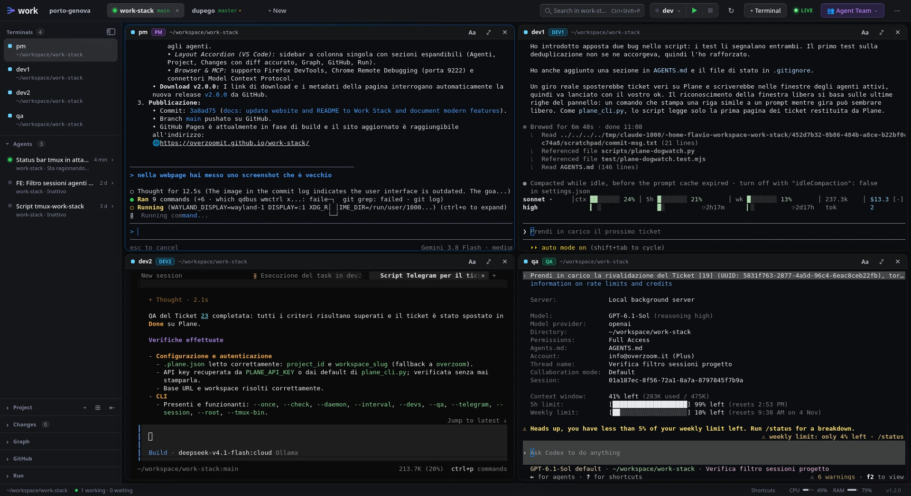

<div align="center">


<h3>The Agent-Native Developer Workspace</h3>

<p>
Una dashboard desktop per sviluppatori che riunisce gestione multi-progetto, terminali tmux persistenti,<br>
una squadra orchestrata di agenti AI, browser docked, Git/GitHub, Fleet Analytics e controllo remoto — in un'unica finestra.
</p>

<p>
  <a href="https://github.com/overzoomit/work-stack/releases"></a>
  
  
  
  
  
  
</p>

<p>
  <a href="#-perché-work-stack">Perché Work</a> ·
  <a href="#-squadra-agenti--mission-control">Squadra Agenti & Mission Control</a> ·
  <a href="#-omni-command-palette-ctrlk">Command Palette</a> ·
  <a href="#-docked-webview--browser-live">Docked Webview</a> ·
  <a href="#-smart-diff-lens">Smart Diff Lens</a> ·
  <a href="#-fleet-analytics-dashboard">Fleet Analytics</a> ·
  <a href="#-time-machine--session-scrubber">Time-Machine</a> ·
  <a href="#-audio-cyberpunk--note-vocali">Audio & Voice</a> ·
  <a href="#-dogwatch--sentinella-plane">Dogwatch & Plane</a> ·
  <a href="#-ponte-remoto-telegram-multi-pm">Telegram Multi-PM</a> ·
  <a href="#-quick-start">Quick start</a>
</p>

</div>

---

## ✦ Perché Work Stack

| Vantaggio | In pratica |
|---|---|
| **Un solo posto per tutto** | Progetti a schede responsive, terminali tmux persistenti con split dinamico, file tree, Smart Diff Lens, GitHub Actions e browser live in una sola app nativa. |
| **Gli agenti non si fermano mai** | PM, Dev, QA, Doc e Generic girano in sessioni tmux persistenti per progetto. Riavvia o chiudi l'app: al ritorno ritrovi processi vivi e scrollback intatto. |
| **Interfaccia ad alta produttività** | Omni-Command Palette (`Ctrl+K`), ricerca in-buffer (`Ctrl+F`), canvas interattivo Mission Control e scrubber Time-Machine per navigare nella storia dei terminali. |
| **Nessuno aspetta l'umano** | Sentinella Dogwatch con manifesti TOML, sezione "Needs You" per sblocco rapido, delega ticket automatica Plane e ponte Telegram Multi-PM con note vocali e prefissi oz. |

```console
$ npm install && npm run dev
```

---

## 👥 Squadra Agenti & Mission Control

Cinque famiglie di ruolo, finestre tmux numerate progressivamente e badge con tint dedicato. Ogni ruolo si avvia con la CLI predefinita oppure con una scelta dal catalogo interattivo (12 CLI agentiche supportate con toggle di bypass permessi).

| Ruolo | Finestra | CLI predefinita | Badge | Descrizione |
|---|---|---|---|---|
| **PM** | `pm` | Antigravity `agy` |  | Requisiti, specifiche, governance e release |
| **DEV** | `dev1`, `dev2`, … | OpenCode su Ollama (DeepSeek) |  | Sviluppo, test unitari e implementazione |
| **QA** | `qa`, `qa1`, … | OpenAI Codex |  | Validazione e2e, regressioni e report |
| **DOC** | `doc1`, `doc2`, … | Claude Code |  | Documentazione, guide, ADR e knowledge base |
| **GENERIC** | `agent1`, `agent2`, … | qualsiasi CLI del catalogo |  | Task ad-hoc, migrazioni, script di supporto |

> Le finestre vivono nella sessione tmux del progetto, che aggiunge l'indice (`0:pm`, `1:dev1`, `2:dev2`, `3:qa`, `4:doc1`, …).

La numerazione è **incrementale**: aggiungi `dev3`, `qa2`, `doc2` o `agent2` e il ruolo eredita comando, hint e colore. Il badge del ruolo convive con il **badge dell'agente** rilevato nella finestra (stesso tint della tile scelta nel launcher).

<details>
<summary><b>Catalogo CLI supportate</b> (12 agenti, avvio nativo e flag bypass permessi)</summary>

| Agente | Comando | Bypass |
|---|---|---|
| Claude Code | `claude` | `--dangerously-skip-permissions` |
| Antigravity | `agy` | `--dangerously-skip-permissions` |
| OpenAI Codex | `codex` | `--dangerously-bypass-approvals-and-sandbox` |
| Gemini CLI | `gemini` | `--yolo` |
| Copilot CLI | `copilot` | `--allow-all-tools` |
| OpenCode | `opencode` | — |
| Ollama OpenCode | `ollama launch opencode --model deepseek-v4.1-flash:cloud` | — |
| Aider | `aider` | `--yes-always` |
| Cursor Agent | `cursor-agent` | `--force` |
| Amp | `amp` | `--dangerously-allow-all` |
| Qwen Code | `qwen` | `--yolo` |
| Goose | `goose session` | — |

</details>

### 🛸 Mission Control Canvas
Un canvas interattivo a nodi renderizzato in SVG reattivo:
- Visualizza la topologia dell'intera squadra e dei terminali attivi.
- Mostra il ticket in lavorazione, il ruolo e lo stato in tempo reale (idle, working, blocked).
- Emette flussi di particelle animate tra PM, Dev e QA durante il passaggio dei task.
- Un clic su qualsiasi nodo porta istantaneamente il focus sul rispettivo terminale.

### 🚨 Centro Attenzioni "Needs You"
Quando uno o più agenti incontrano una richiesta di conferma (`[y/N]`, selezione menù o domanda aperta), la card **Needs You** compare automaticamente in cima alla Squadra Agenti. Permette di sbloccare l'agente con un clic sulle opzioni raccomandate o digitando una risposta personalizzata, senza dover cercare la finestra terminale specifica.

### Il diodo Live in barra superiore
| LED | Significato |
|---|---|
| 🟢 **Live** | Dogwatch è attivo e sta monitorando la sessione tmux del progetto corrente. |
| 🟠 **Blocked** | Uno o più agenti attendono una decisione o conferma: escalation pendente. |
| ⚫ **Off** | Nessuna sessione tmux attiva per il progetto corrente. |

---

## ⌨️ Omni-Command Palette (Ctrl+K)

La barra di comando modale universale per dominare l'intero ambiente di sviluppo senza staccare le mani dalla tastiera (`Ctrl+K`, `⌘K` su macOS):

- **Ricerca fuzzy unificata**: digita per cercare istantaneamente tra:
  - File del progetto aperto (con anteprima del percorso relativo).
  - Rami Git locali e remoti (con checkout rapido).
  - Agenti della squadra (focus immediato sulla finestra tmux).
  - Ticket del backlog Plane (apertura e ispezione).
  - Comandi rapidi di sistema (nuovo terminale, split, agente con prompt, ngrok, impostazioni).
- **Zero interferenze**: gestione della concorrenza che cancella le ricerche superate e preserva il focus del cursore all'uscita (`Esc`).

---

## 🌐 Docked Webview & Browser Live

Un browser leggero che vive dentro la griglia dei terminali, come split pane con badge **WEB**:

- **Apertura contestuale**: compare come split quando un dev server stampa un indirizzo locale (toast *"Web server detected"* → **Open in Preview**), dal pulsante **Preview** della barra Run, dal menu contestuale del terminale (*Open in Preview*) o da *New browser preview* sull'area terminali.
- **Autodiscovery degli indirizzi**: riconosce qualsiasi URL `localhost`/`127.0.0.1`/`0.0.0.0`/`[::1]` con porta, così vale per 3000, 5173, 8080 o una porta personalizzata.
- **Barra di navigazione completa**: input URL, indietro/avanti, ricarica e apertura nel browser di sistema.
- **Viewport**: preset **Desktop** e **Mobile** per verificare al volo il layout responsive.
- **Snapshot QA a 1-Click**: cattura lo schermo con lo strumento di sistema disponibile (`grim`, `spectacle`, `gnome-screenshot` o ImageMagick su Linux) e salva il PNG nella cartella `snapshots/` dei dati applicativi, con toast per aprirlo nel file manager.

---

## 🔍 Smart Diff Lens

Nel visualizzatore modifiche Git, la Smart Diff Lens aggiunge un'analisi automatica e deterministica del diff, senza chiamate a servizi esterni:

- **Spiegazione contestuale delle modifiche**: riassume file toccati, righe aggiunte/rimosse, simboli introdotti e aree del progetto coinvolte, distinguendo working tree e stage.
- **Generatore di Commit Conventional**: propone un messaggio conforme allo standard Conventional Commits (`feat(...)`, `fix(...)`, `test(...)`, `chore(...)`) basandosi esclusivamente sulle modifiche staged; il messaggio resta modificabile prima del commit.
- **Troncamento intelligente**: gestisce diff estesi proteggendo l'interfaccia da blocchi e preservando le porzioni di codice rilevanti.

---

## 📊 Fleet Analytics Dashboard

Metriche di telemetria e prestazioni della squadra agenti accessibili in tempo reale:

- **KPI Operativi**: token consumati (con stima dei costi per modello), tempo medio del ciclo Dev→QA→Done, percentuale di superamento QA al primo colpo e conteggio delle sessioni.
- **Grafici SVG nativi**: sparkline del trend di ticket chiusi e sessioni attive, più barre orizzontali di token e spesa per modello (nessuna libreria di charting).
- **Riepilogo per agente**: sessioni, token, costo stimato e durata media per ogni CLI (Claude Code, Antigravity, OpenCode…), lette dai file di storico che gli agenti già scrivono.

---

## ⏳ Time-Machine & Session Scrubber

Non perdere mai l'output di un terminale o lo storico di una compilazione passata:

- **Timeline scrollback interattiva**: registra snapshot periodici del buffer terminale tmux conservando i cambiamenti significativi.
- **Scrubber visivo**: scorri indietro nel tempo lo slider per ispezionare esattamente cosa stava stampando l'agente minuti o ore fa.
- **Fork Session**: apre una nuova finestra tmux nella stessa cartella del pane, con lo snapshot selezionato già nello scrollback, così riparti da quel contesto senza toccare la finestra originale.

---

## 🔊 Audio Cyberpunk & Note Vocali

Un'esperienza sensoriale moderna pensata per l'automazione autonoma:

- **Sintetizzatore audio procedurale**: realizzato con Web Audio API pura (senza asset audio pesanti), genera notifiche sonore contestuali per l'avvio della squadra, il completamento di un ticket, la ricezione di messaggi o un blocco critico Dogwatch.
- **Note vocali Telegram**: i messaggi vocali inviati al Bot dal PM vengono scaricati nella cache dell'app e inoltrati al PM con il percorso del file da trascrivere, insieme alla richiesta da gestire.

---

## 🧵 Orchestrazione tmux & Terminali


- **Una sessione persistente per progetto**: Work adotta la sessione tmux con il nome della cartella (es. `work-stack`) o ne crea una deterministica `work_<nome>_<hash>`.
- **PTY nativi con Split-Pane**: ogni riquadro è un terminale `portable-pty` (xterm.js 6) con supporto a split orizzontale e verticale nativo, resize, controllo di flusso e ack.
- **Ricerca In-Buffer (`Ctrl+F`)**: barra di ricerca integrata nel terminale xterm con evidenziazione concorrente e conteggio occorrenze.
- **Detach pulito e re-attach automatico**: alla chiusura l'app fa detach; al riavvio riaggancia tutte le finestre esistenti.
- **Progetti SSH remoti**: gestione trasparente di sessioni tmux remote via `ssh -t`.

---

## 👁 Dogwatch & Sentinella Plane

Dogwatch è la sentinella **reattiva** della squadra: rileva quando un agente si blocca, classifica il prompt e lo consegna al PM.


- **Manifesti TOML dichiarativi**: `src-tauri/detect/manifests/*.toml` descrivono per ogni CLI le regole regex, la priorità e il tipo di prompt (`confirm`, `question`, `menu`).
- **Snapshot condiviso e lock atomico**: app, script e CLI leggono lo stesso `.claude/dogwatch_state.json`.

### Delega automatica dei ticket Plane
`plane_dogwatch` (nativo in Rust e script Python) collega il backlog Plane alle finestre tmux del progetto con sincronizzazione dello stato e notifiche formattate con prefisso oz `[{progetto}]`:

```text
Re-open ──▶ al dev che aveva il ticket (o al primo libero) ──▶ In Progress
Todo    ──▶ al primo dev libero                          ──▶ In Progress
Test    ──▶ a qa1 / qa                                   ──▶ Done oppure Re-open
Done    ──▶ notifica al PM su Telegram con tag [progetto]
```

---

## ⌨️ CLI inter-agente `work-agent`

Un protocollo deterministico per far coordinare i terminali tra loro:

```bash
# Chi c'è, con quale agente e in che stato
$ python3 scripts/work-agent.py list
dev1	idle	opencode
qa1	idle	codex

# Assegna un task a un'altra finestra
$ python3 scripts/work-agent.py prompt dev1 "esegui la suite di regressione"

# Aspetta che torni idle
$ python3 scripts/work-agent.py wait dev1 --until idle --timeout 600

# Leggi le ultime righe pulite da ANSI e box
$ python3 scripts/work-agent.py read dev1 --lines 40 --clean
```

---

## 🌐 Ponte remoto Telegram Multi-PM

Controllo remoto dallo smartphone per team multi-progetto:

- **Instradamento Multi-Progetto**: un solo bot Telegram gestisce tutti i progetti aperti in Work Stack.
- **Comandi integrati**:
  - `/projects` o `/progetti`: elenca tutti i progetti aperti con stato attivo e sessioni tmux.
  - `/use <nome o indice>`: fissa il target su un progetto specifico.
  - `/use auto`: reimposta il routing affinché segua automaticamente il progetto attivo nella finestra di Work.
  - `@<progetto> <messaggio>`: invia un'istruzione one-shot al PM di un progetto specifico.
  - **Risposta via Reply**: rispondere con il Reply a un messaggio inoltrato (incluso il completamento ticket) reindirizza la risposta direttamente al PM del rispettivo repository.
- **Prefisso Conforme a oz**: i ticket completati riportano il tag del repository (`[mirada] ✅ Ticket [13] completato...`), garantendo chiarezza visiva e routing bidirezionale garantito.

---

## 🧭 Layout & feature matrix

Sidebar a colonna singola con sezioni **accordion** in stile VS Code, tutte richiudibili:



| Ambito | Cosa include | Stato |
|---|---|---|
| **Progetti** | Tab responsive con scroll orizzontale, persistenza, apertura da CLI (`work .`), progetti SSH | ✅ |
| **Terminali** | Griglia PTY, split orizzontale/verticale, ricerca in-buffer (`Ctrl+F`), tmux persistente | ✅ |
| **Squadra Agenti** | PM, DEV, QA, DOC, GENERIC, numerazione dinamica, 12 CLI, badge con tint e rilevamento reale | ✅ |
| **Mission Control** | Canvas interattivo a nodi SVG, flusso di particelle animate, stato live dei task | ✅ |
| **Needs You** | Bacheca in primo piano per risoluzione istantanea di prompt Dogwatch | ✅ |
| **Command Palette** | Omni-palette universale (`Ctrl+K`) con fuzzy search su file, rami, ticket e azioni | ✅ |
| **Docked Webview** | Browser affiancato al codice (`Preview` da toast/Run/menu contestuale), autodiscovery URL locali, snapshot QA | ✅ |
| **Smart Diff Lens** | Spiegazione automatica deterministica del diff e generazione commit Conventional | ✅ |
| **Fleet Analytics** | Dashboard telemetria per agente, token e costi, tempo di ciclo, pass-rate QA, grafici SVG | ✅ |
| **Time-Machine** | Scrubber dello scrollback terminale con snapshot timeline e fork sessione tmux | ✅ |
| **Audio Cyberpunk** | Sintetizzatore procedurale eventi, notifiche sonore e note vocali Telegram inoltrate al PM | ✅ |
| **Telegram Multi-PM**| Controllo multi-progetto, comandi `/projects` e `/use`, reply tracking e tag oz | ✅ |
| **Dogwatch & PM Relay** | Manifesti TOML, LED Live/Blocked/Off, relay automatico al PM (`0:pm`) idle con risposta autonoma o inoltro Telegram | ✅ |
| **Plane-Dogwatch** | Delega autonoma ticket Plane, sincronizzazione bidirezionale, lock condiviso | ✅ |
| **work-agent** | CLI inter-agente (`list`, `prompt`, `wait`, `read`) con reset per OpenCode | ✅ |
| **Albero file** | Preview Markdown/HTML sanificata, editing UTF-8, ricerca fuzzy e grep | ✅ |
| **Sicurezza FS** | Sandbox sui perimetri `Roots`, protezione da traversal e symlink | ✅ |
| **Changes & Graph** | Staging atomico, commit, diff affiancato/unificato word-level, grafo commit | ✅ |
| **GitHub** | Actions (run/job/log), workflow dispatch, secrets, artifacts | ✅ |
| **Run & ngrok** | Autodiscovery comandi Run, tunnel ngrok per progetto (http/tcp/tls) | ✅ |
| **Settings Modal** | Modale centralizzato con tab Plane, Jev, Environment, Audio e Portability, API key salvate in un file leggibile solo dall'utente | ✅ |
| **Estetica** | 10 temi, dimensione testo, cursore, materiali traslucidi, icona nativa | ✅ |

> ✅ = stabile nella release **v2.15.0**.

### Scorciatoie da tastiera

| Tasti | Azione |
|---|---|
| `Ctrl+K` / `⌘K` | **Omni-Command Palette** (ricerca file, rami, ticket, agenti, azioni) |
| `Ctrl+,` / `⌘,` | **Impostazioni** (Plane, Jev, ambiente, audio, portabilità) |
| `Ctrl+F` | **Cerca nel terminale** attivo (in-buffer search con highlight concorrente) |
| `Ctrl+Shift+P` / `⌘P` | Ricerca rapida file (fuzzy match) |
| `Ctrl+Shift+F` | Ricerca testo nel progetto (grep globale); dentro un terminale cerca nel buffer |
| `Ctrl+Shift+T` | Nuovo terminale standard |
| `Ctrl+Shift+A` | Nuovo agente della squadra |
| `Ctrl+Shift+O` | Apri un altro progetto (fuori dal terminale) / **split destro** (dentro un terminale) |
| `Ctrl+Shift+E` | **Split verso il basso** del terminale attivo |
| `Ctrl+Shift+W` / `⌘W` | Chiudi il terminale attivo |
| `Ctrl+Shift+M` | Ingrandisci / ripristina terminale a tutto schermo |
| `Ctrl+Shift+B` | Mostra / nascondi sidebar accordion |
| `Ctrl+Shift+O` | Apri un altro progetto da cartella |
| `Ctrl+Shift+C` / `Ctrl+Shift+V` | Copia / incolla nel terminale |
| `Ctrl+S` / `⌘S` | Salva il file in modifica |
| `Ctrl+Enter` | Esegui commit |
| `F5` | Ricarica albero file e stato Git |
| `Ctrl+F5` / `Shift+F10` | Avvia o riesegui la configurazione Run |
| `Ctrl+F2` | Ferma il processo Run attivo |
| `F7` / `Shift+F7` | Modifica successiva / precedente nel diff |
| `Ctrl+=` / `Ctrl+-` / `Ctrl+0` | Dimensione testo terminale |
| `Esc` | Chiude overlay, modali, palette o pannello aperto |

---

## 🚀 Quick start

```bash
git clone https://github.com/overzoomit/work-stack.git
cd work-stack
npm install          # scarica anche le librerie vendor (xterm, marked, DOMPurify)
npm run dev
```

Per aprire direttamente un repository specifico:

```bash
WORK_CWD=~/progetti/mio-repo npm run dev
work ~/progetti/mio-repo          # dopo l'installazione del binario
work                              # ripristina sessione e progetti salvati
```

### Prerequisiti

- **Node.js** 22+ e **Rust** stable ([rustup.rs](https://rustup.rs)).
- **Git** e **tmux**.
- **Linux (Ubuntu/Debian/Arch/Fedora)**: `libwebkit2gtk-4.1-dev`, `build-essential`, `libssl-dev`, `libayatana-appindicator3-dev`, `librsvg2-dev`.
- **macOS**: Xcode Command Line Tools.
- **Opzionali**: `gh` per GitHub, `ngrok` per i tunnel, le CLI degli agenti che vuoi usare.

### Build & install

```bash
npm run build           # bundle in src-tauri/target/release/bundle/
npm run install:linux   # Linux: ~/.local/bin + icone desktop
npm run clean           # svuota la cartella target per liberare spazio su disco
```

---

## 🏗 Architettura

```text
work-stack/
├── src-tauri/                    # Backend Rust (Tauri 2, edition 2021)
│   ├── src/
│   │   ├── main.rs               # Bootstrap, IPC, lifecycle, resolver progetti
│   │   ├── app.rs                # Finestra, menu di sistema, update, CLI `work`
│   │   ├── tmux.rs               # Sessioni, finestre, split-pane e Time Machine
│   │   ├── pty.rs                # Terminali portable-pty e controllo di flusso
│   │   ├── remote.rs             # Progetti SSH e tmux remoto
│   │   ├── dogwatch.rs           # Rilevamento prompt, manifesti, escalation
│   │   ├── plane_dogwatch.rs     # Delega ticket Plane → agenti con tag oz
│   │   ├── agents.rs             # Sessioni transcript, processi agente, Smart Diff
│   │   ├── claudeprocs.rs        # Rilevamento processi agenti CLI
│   │   ├── analytics.rs          # Aggregazione telemetria per Fleet Analytics
│   │   ├── telegram.rs           # Router Telegram Multi-Progetto & Multi-PM
│   │   ├── webview.rs            # Snapshot QA del Docked Webview
│   │   ├── ngrok.rs              # Un tunnel per progetto
│   │   ├── settings.rs           # API key e preferenze globali
│   │   ├── plugins.rs            # Plugin globali Claude Code
│   │   ├── mcp.rs                # Server MCP, Firefox DevTools e Chrome 9222
│   │   ├── fsops.rs              # Filesystem sandboxato (Roots)
│   │   ├── git.rs / gitwatch.rs  # CLI git, Smart Diff e watcher reattivo
│   │   ├── github.rs             # gh CLI: Actions, secrets, artifacts
│   │   ├── runconfigs.rs         # Autodiscovery comandi Run
│   │   ├── store.rs              # Persistenza atomica
│   │   ├── sysstats.rs           # CPU / RAM
│   │   └── diag.rs               # Log ed esportazione diagnostica
│   └── detect/manifests/         # Regole TOML per ogni CLI agente (6 file)
├── src/renderer/                 # Frontend vanilla ES Modules (no bundler)
│   ├── index.html                # Shell dell'app
│   ├── bridge.js                 # window.work sopra IPC Tauri
│   ├── app.js / accordion.js     # Layout, progetti, tab bar responsive
│   ├── tabstrip.js / ptabled.js  # Tab progetti elastiche e griglia terminali
│   ├── team.js / teamroles.js    # Squadra Agenti, ruoli e Needs You
│   ├── agent_graph.js            # Mission Control canvas SVG e particelle
│   ├── agentcatalog.js           # Catalogo delle 12 CLI agentiche
│   ├── agentsview.js             # Vista agenti, transcript e avvio
│   ├── palette.js                # Omni-Command Palette (Ctrl+K)
│   ├── webview_pane.js           # Docked Webview, viewport e snapshot
│   ├── analytics.js              # Fleet Analytics e grafici SVG
│   ├── sound.js                  # Sintetizzatore audio procedurale
│   ├── terminals.js              # Griglia terminali, split e Time Machine
│   ├── terminalsearch.js         # Ricerca in-buffer (Ctrl+F)
│   ├── tree.js / preview.js      # Albero file, anteprima, editing
│   ├── search.js                 # Ricerca fuzzy file e grep di progetto
│   ├── diff.js / review.js       # Smart Diff Lens, review sheet, commit
│   ├── gitpanel.js / graph.js    # Pannello Git e grafo commit
│   ├── github.js                 # Actions, workflow, secrets, artifacts
│   ├── run.js / runurl.js        # Run, Preview e URL locali
│   ├── ngrok.js / plugins.js     # Tunnel e plugin
│   ├── mcp.js / remotedialog.js  # MCP e dialog SSH
│   ├── remoteproject.js          # Badge e percorsi dei progetti SSH
│   ├── settings.js               # Modale Settings a tab
│   ├── appearance.js / themes.js # Temi (10), font, cursore
│   ├── onboarding.js / launcher.js# Primo avvio e avvio agenti
│   ├── keys.js / ui.js / update.js# Scorciatoie, toast, banner aggiornamenti
│   ├── chunks.js / paths.js / escape.js # Utility condivise
│   └── style.css                 # Design system scuro
├── scripts/
│   ├── work-agent.py             # CLI inter-agente (list/prompt/wait/read)
│   ├── plane-dogwatch.py         # Sentinella ticket Plane con prefisso oz
│   ├── tmux-dogwatch.py          # Escalation e risposta alle finestre tmux
│   ├── telegram-pm.py            # Notifiche e note vocali del PM
│   ├── plane-cli.py              # CLI locale per il backlog Plane
│   ├── install-linux.sh          # Binario, icone desktop e auto-clean target
│   └── vendor.mjs                # Librerie vendor (xterm, marked, DOMPurify)
├── assets/                       # Hero, diagrammi e icone
├── docs/                         # Knowledge base, ADR, agent docs, landing page GitHub Pages
└── test/                         # Suite Node.js (unit + regressione) e test/e2e
```

---

## 🧪 Test & qualità

Prima di ogni commit o passaggio di stato di un ticket:

```bash
npm test                                                     # 486 test Node + 403 test Rust (3 test GitHub reali restano #[ignore])
npm run test:e2e                                             # build debug con feature e2e + smoke test end-to-end
cargo clippy --manifest-path src-tauri/Cargo.toml --all-targets -- -D warnings
cargo fmt --manifest-path src-tauri/Cargo.toml -- --check
```

I tre test Rust marcati `#[ignore]` (`real_secret_roundtrip`, `real_artifact_download`, `real_status`) parlano con GitHub vero e si lanciano a mano con `--ignored`.

---

## 📚 Documentazione

- [Knowledge Base architetturale](docs/KNOWLEDGE_BASE.md)
- [Glossario di dominio](GLOSSARY.md)
- [Architecture Decision Records](docs/adr/)
- [Note per gli agenti](docs/agents/)
- [Sito web ufficiale](https://overzoomit.github.io/work-stack/)

---

<div align="center">

**Work Stack** — costruito con Rust, Tauri 2 e moduli ES vanilla.<br>
Nessun framework, nessun bundler: solo il desktop che serve alla squadra.

<sub>Progetto privato · tutti i diritti riservati.</sub>

</div>
