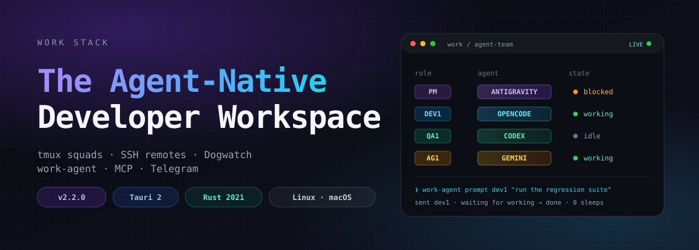
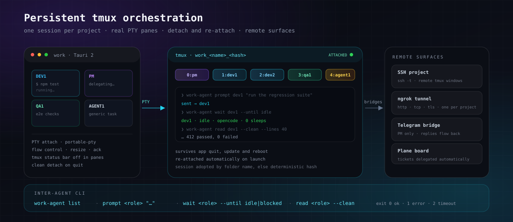
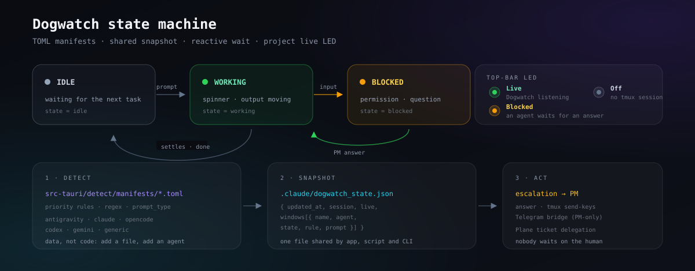

<div align="center">



<h3>The Agent-Native Developer Workspace</h3>

<p>
Una dashboard desktop per sviluppatori che riunisce progetti, terminali tmux persistenti,<br>
una squadra di agenti AI, Git/GitHub, editing file e controllo remoto — in un'unica finestra.
</p>

<p>
  <a href="https://github.com/overzoomit/work-stack/releases"></a>
  
  
  
  
  
  
</p>

<p>
  <a href="#-perché-work-stack">Perché Work</a> ·
  <a href="#-squadra-agenti">Squadra Agenti</a> ·
  <a href="#-orchestrazione-tmux">Orchestrazione</a> ·
  <a href="#-dogwatch">Dogwatch</a> ·
  <a href="#-cli-inter-agente-work-agent">work-agent</a> ·
  <a href="#-quick-start">Quick start</a>
</p>

</div>

---

## ✦ Perché Work Stack

| | |
|---|---|
| **Un solo posto per tutto** | Progetti, terminali, file, Git, GitHub, run e agenti vivono nella stessa finestra: niente più dieci schede e quattro terminali sparsi. |
| **Gli agenti non si fermano** | PM, sviluppatori e QA girano in una sessione tmux persistente per progetto. Chiudi l'app, aggiornala o riavvia: al ritorno le finestre sono ancora lì, con lo scrollback intatto. |
| **La squadra parla da sola** | `work-agent` coordina i terminali tra loro: prompt, attesa di uno stato e lettura dell'output, senza copiare e incollare tra finestre. |
| **Nessuno aspetta l'umano** | Dogwatch intercetta i prompt bloccati, li classifica con manifesti TOML e li escala al PM. Il PM risponde in autonomia o inoltra la decisione su Telegram. |

```console
$ npm install && npm run dev
```

---

## 👥 Squadra Agenti

Quattro famiglie di ruolo, finestre tmux numerate e badge con un tint dedicato. Ogni ruolo parte con la CLI predefinita della squadra, ma puoi sceglierne un'altra dal catalogo agenti.

| Ruolo | Finestra | CLI predefinita | Badge |
|---|---|---|---|
| **PM** — requisiti, priorità, release | `0:pm` | Antigravity `agy` |  |
| **DEV** — sviluppo e test | `1:dev1`, `2:dev2`, … | OpenCode su Ollama |  |
| **QA** — validazione end-to-end | `3:qa1`, `4:qa2`, … | OpenAI Codex |  |
| **GENERIC** — task ad-hoc | `agent1`, `agent2`, … | qualsiasi CLI del catalogo |  |

La numerazione è **incrementale**: aggiungi `dev3`, `qa2` o `agent2` e il ruolo eredita automaticamente comando, hint e colore. Il badge del ruolo convive con il **badge dell'agente** rilevato nella finestra (stesso tint della tile scelta nel launcher).

<details>
<summary><b>Catalogo CLI supportate</b> (12 agenti, avvio nativo e flag bypass permessi)</summary>

| Agente | Comando | Bypass |
|---|---|---|
| Claude Code | `claude` | `--dangerously-skip-permissions` |
| Antigravity | `agy` | `--dangerously-skip-permissions` |
| OpenAI Codex | `codex` | `--dangerously-bypass-approvals-and-sandbox` |
| Gemini CLI | `gemini` | `--yolo` |
| Copilot CLI | `copilot` | `--allow-all-tools` |
| OpenCode | `opencode` | — |
| Ollama OpenCode | `ollama launch opencode --model …` | — |
| Aider | `aider` | `--yes-always` |
| Cursor Agent | `cursor-agent` | `--force` |
| Amp | `amp` | `--dangerously-allow-all` |
| Qwen Code | `qwen` | `--yolo` |
| Goose | `goose session` | — |

</details>

### Il diodo Live in barra

Lo stato della squadra è sempre a colpo d'occhio:

| LED | Significato |
|---|---|
| 🟢 **Live** | Dogwatch è attivo e sta ascoltando la sessione tmux del progetto. |
| 🟠 **Blocked** | Uno o più agenti attendono una risposta: c'è un'escalation da gestire. |
| ⚫ **Off** | Nessuna sessione tmux attiva per il progetto. |

---

## 🧵 Orchestrazione tmux



- **Una sessione per progetto**: Work adotta la sessione tmux con il nome della cartella (es. `work-stack`) o ne crea una deterministica `work_<nome>_<hash>`.
- **PTY veri**: ogni riquadro è un terminale `portable-pty` (xterm.js 6) collegato alla finestra tmux, con resize, controllo di flusso e ack.
- **Detach pulito, re-attach automatico**: alla chiusura l'app fa detach; al riavvio riaggancia tutte le finestre esistenti e riprende i processi rimasti vivi. La status bar tmux resta spenta nei riquadri dell'app e attiva nei client esterni.
- **Resume dopo reboot**: le finestre agente attive vengono ripristinate automaticamente con `agent_resume`.
- **Progetti SSH**: host, utente, porta, path e nome sessione opzionali; Work apre un PTY su `ssh -t` e gestisce le finestre tmux remote come quelle locali.

```text
work_<name>_<hash>
├── 0:pm        agy --dangerously-skip-permissions
├── 1:dev1      ollama launch opencode --model deepseek-v4.1-flash:cloud
├── 2:dev2      ollama launch opencode --model deepseek-v4.1-flash:cloud
├── 3:qa1       codex --dangerously-bypass-approvals-and-sandbox
└── 4:agent1    <qualsiasi CLI del catalogo>
```

---

## 👁 Dogwatch

Dogwatch è la sentinella **reattiva** della squadra: rileva quando un agente si blocca, classifica il prompt e lo consegna al PM.



- **Manifesti TOML, non codice**: `src-tauri/detect/manifests/*.toml` descrivono per ogni CLI le regole regex, la priorità e il tipo di prompt (`confirm`, `question`, `menu`, …). Aggiungere un agente significa aggiungere un file.
- **Snapshot condiviso**: app, script e CLI leggono lo stesso `.claude/dogwatch_state.json` — nessun polling concorrente delle pane.
- **Anti falsi positivi**: i prompt sono validi solo se sono l'ultimo output della finestra; i log storici e le righe di chrome (spinner, hint di tasti, bordi) vengono scartati.
- **Escalation al PM**: `dogwatch_inspect` / `dogwatch_answer` dall'app, `tmux-dogwatch.py answer <finestra> "…"` da terminale, oppure una risposta Telegram. Il PM decide; il dev non resta mai appeso.

### Delega automatica dei ticket Plane

`plane_dogwatch` (nativo in Work) e `scripts/plane-dogwatch.py` condividono stato e lock, quindi possono girare insieme senza deleghe doppie:

```text
Re-open ──▶ al dev che aveva il ticket (o al primo libero) ──▶ In Progress
Todo    ──▶ al primo dev libero                          ──▶ In Progress
Test    ──▶ a qa1 / qa                                   ──▶ Done oppure Re-open
Done    ──▶ notifica al PM su Telegram
```

---

## ⌨️ CLI inter-agente `work-agent`

Un protocollo deterministico per far parlare i terminali tra loro. Legge lo snapshot di Dogwatch invece di interrogare le pane, quindi attendere un collega non sporca il terminale.

```bash
# Chi c'è, con quale agente e in che stato
$ work-agent list
dev1	idle	opencode
qa1	idle	codex
agent1	idle	generic

# Assegna un task a un'altra finestra
$ work-agent prompt dev1 "esegui la suite di regressione"

# Aspetta che torni idle (esce 2 dopo il timeout)
$ work-agent wait dev1 --until idle --timeout 600

# Leggi le ultime righe, ripulite da ANSI e bordi
$ work-agent read dev1 --lines 40 --clean
```

| Comando | Descrizione |
|---|---|
| `work-agent list` | Elenca le finestre agente con stato, agente e regola che ha matchato. |
| `work-agent prompt <role> "<testo>"` | Invia un'istruzione alla finestra, con marcatore anti-race. |
| `work-agent wait <role> [--until blocked\|idle\|done] [--timeout SEC]` | Attende uno stato; `--timeout 0` attende per sempre. |
| `work-agent read <role> [--lines N] [--clean]` | Legge l'output recente; `--clean` rimuove ANSI, box e hint. |

Exit code: `0` successo · `1` errore · `2` timeout. Opzioni globali: `--session`, `--root`, `--state`, `--tmux-bin`.

---

## 🌐 Ponte remoto

### Telegram (solo PM)

Controllo remoto della squadra dallo smartphone, con risposte bidirezionali:

1. Connetti il bot da **Agent Team → Telegram** (token `@BotFather` + chat ID autorizzato).
2. Work salva la configurazione in `telegram.json` con permessi `0600` e la ripristina a ogni avvio.
3. Il PM riceve escalation e riepiloghi; le risposte tornano all'agente bloccato.
4. Solo il PM parla con il bot: nessun dev o QA invia, riceve o legge messaggi.

```bash
python3 scripts/telegram-pm.py send "Release v2.2.0 pronta per il QA"
```

### ngrok

Un tunnel per progetto dal menu **Run → ngrok Tunnel…**:

- protocolli `http`, `tcp`, `tls` e dominio personalizzato;
- URL pubblico letto dall'API di ispezione dell'agente (porta presa dal log JSON, mai assunta);
- stato e URL aggiornati in tempo reale; tutti i tunnel vengono chiusi all'uscita da Work.

---

## 🧭 Layout & feature matrix

Sidebar a colonna singola con sezioni **accordion** in stile VS Code, tutte richiudibili:

| Ambito | Cosa include | Stato |
|---|---|---|
| **Progetti** | Tab multipli, persistenza, apertura da CLI (`work .`), progetti SSH remoti | ✅ |
| **Terminali** | Griglia PTY, split, rename, drag tra progetti, tmux persistente e re-attach | ✅ |
| **Squadra Agenti** | PM/DEV/QA/GENERIC, numerazione dinamica, 12 CLI, badge tint, resume post-reboot | ✅ |
| **Dogwatch** | Manifesti TOML, LED Live/Blocked/Off, escalation, risposta da app/CLI/Telegram | ✅ |
| **Plane** | Delega automatica dei ticket, commenti tecnici, lock condiviso con lo script | ✅ |
| **work-agent** | `list`, `prompt`, `wait`, `read` con exit code deterministici | ✅ |
| **Albero file** | Preview Markdown/HTML sanificata, editing UTF-8, ricerca fuzzy e grep | ✅ |
| **Sicurezza FS** | Sandbox sui perimetri `Roots`, protezione da traversal e symlink | ✅ |
| **Changes & Graph** | Staging atomico, commit, diff affiancato/unificato word-level, grafo commit | ✅ |
| **GitHub** | Actions (run/job/log), workflow dispatch, secrets, artifacts | ✅ |
| **Run** | Autodiscovery npm/Make/Cargo/Django/Go/Docker, run/stop, URL locali | ✅ |
| **MCP & Browser** | Stato server MCP, Firefox DevTools, Chrome remote debugging 9222 | ✅ |
| **Plugin** | Manager globale plugin Claude Code: install da GitHub, update, remove | ✅ |
| **Estetica** | 10 temi, dimensione testo, cursore, materiali traslucidi, icona nativa | ✅ |
| **Diagnostica** | Gauge CPU/RAM, log export, update check integrato | ✅ |

> ✅ = stabile nella release **v2.2.0**.

### Scorciatoie da tastiera

| Tasti | Azione |
|---|---|
| `Ctrl+Shift+P` / `⌘P` | Ricerca rapida file (fuzzy match) |
| `Ctrl+Shift+F` | Ricerca testo nel progetto |
| `Ctrl+Shift+T` | Nuovo terminale |
| `Ctrl+Shift+A` | Nuovo agente (ultimo usato) |
| `Ctrl+Shift+W` / `⌘W` | Chiudi il terminale attivo |
| `Ctrl+Shift+M` | Ingrandisci / ripristina terminale |
| `Ctrl+Shift+B` | Mostra / nascondi sidebar |
| `Ctrl+Shift+O` | Apri un altro progetto |
| `Ctrl+Shift+C` / `Ctrl+Shift+V` | Copia / incolla nel terminale |
| `Ctrl+S` / `⌘S` | Salva il file in modifica |
| `Ctrl+Enter` | Esegui commit |
| `F5` | Ricarica albero file e stato Git |
| `Ctrl+F5` / `Shift+F10` | Avvia o riesegui la configurazione Run |
| `Ctrl+F2` | Ferma il processo Run attivo |
| `F7` / `Shift+F7` | Modifica successiva / precedente nel diff |
| `Ctrl+=` / `Ctrl+-` / `Ctrl+0` | Dimensione testo terminale |
| `Esc` | Chiude overlay, palette o pannello aperto |

---

## 🚀 Quick start

```bash
git clone https://github.com/overzoomit/work-stack.git
cd work-stack
npm install          # scarica anche le librerie vendor (xterm, marked, DOMPurify)
npm run dev
```

Per aprire direttamente un repository specifico:

```bash
WORK_CWD=~/progetti/mio-repo npm run dev
work ~/progetti/mio-repo          # dopo l'installazione del binario
work                              # ripristina sessione e progetti salvati
```

### Prerequisiti

- **Node.js** 22+ e **Rust** stable ([rustup.rs](https://rustup.rs)).
- **Git** e **tmux**.
- **Linux (Ubuntu/Debian/Arch)**: `libwebkit2gtk-4.1-dev`, `build-essential`, `libssl-dev`, `libayatana-appindicator3-dev`, `librsvg2-dev`.
- **macOS**: Xcode Command Line Tools.
- **Opzionali**: `gh` per GitHub, `ngrok` per i tunnel, le CLI degli agenti che vuoi usare.

### Build & install

```bash
npm run build           # bundle in src-tauri/target/release/bundle/
npm run install:linux   # Linux: ~/.local/bin + icone desktop
```

---

## 🏗 Architettura

```text
work-stack/
├── src-tauri/                    # Backend Rust (Tauri 2, edition 2021)
│   ├── src/
│   │   ├── main.rs               # Bootstrap, IPC, lifecycle
│   │   ├── tmux.rs               # Sessioni e finestre tmux per progetto
│   │   ├── pty.rs                # Terminali portable-pty e controllo di flusso
│   │   ├── remote.rs             # Progetti SSH e tmux remoto
│   │   ├── dogwatch.rs           # Rilevamento prompt, manifesti, escalation
│   │   ├── plane_dogwatch.rs     # Delega ticket Plane → agenti
│   │   ├── agents.rs             # Sessioni transcript e processi agente
│   │   ├── claudeprocs.rs        # Rilevamento processi agenti CLI
│   │   ├── telegram.rs           # Bridge bot PM-only e risposte
│   │   ├── ngrok.rs              # Un tunnel per progetto
│   │   ├── plugins.rs            # Plugin globali Claude Code
│   │   ├── mcp.rs                # Server MCP e browser
│   │   ├── fsops.rs              # Filesystem sandboxato (Roots)
│   │   ├── git.rs / gitwatch.rs  # CLI git e watcher reattivo su .git
│   │   ├── github.rs             # gh CLI: Actions, secrets, artifacts
│   │   ├── runconfigs.rs         # Autodiscovery comandi Run
│   │   ├── store.rs              # Persistenza atomica
│   │   ├── sysstats.rs           # CPU / RAM
│   │   └── diag.rs / app.rs      # Log, menu, update, lifecycle finestra
│   └── detect/manifests/         # Regole TOML per ogni CLI agente
├── src/renderer/                 # Frontend vanilla ES Modules (no bundler)
│   ├── bridge.js                 # window.work sopra IPC Tauri
│   ├── app.js / accordion.js     # Layout, progetti, sezioni collapsible
│   ├── team.js / teamroles.js    # Squadra Agenti e ruoli canonici
│   ├── terminals.js              # Griglia terminali e auto-attach tmux
│   ├── agentcatalog.js           # Catalogo agenti e tint dei badge
│   ├── tree.js / preview.js      # Albero file, anteprima, editing
│   ├── diff.js / review.js       # Diff e review sheet
│   ├── graph.js / github.js      # Grafo commit e GitHub
│   ├── run.js / runurl.js        # Run e URL locali
│   ├── ngrok.js / plugins.js     # Tunnel e plugin
│   ├── mcp.js / remotedialog.js  # MCP e dialog SSH
│   ├── appearance.js / themes.js # Temi, font, cursore
│   └── style.css                 # Design system scuro
├── scripts/
│   ├── work-agent.py             # CLI inter-agente (list/prompt/wait/read)
│   ├── plane-dogwatch.py         # Sentinella ticket Plane
│   ├── tmux-dogwatch.py          # Escalation e risposta alle finestre tmux
│   ├── telegram-pm.py            # Notifiche PM-only
│   ├── install-linux.sh          # Binario e icone desktop
│   └── vendor.mjs                # Librerie vendor
├── assets/                       # Hero, diagrammi e icone
├── docs/                         # Knowledge base, ADR, agent docs, screenshot
└── test/                         # Suite Node.js (unit + regressione)
```

---

## 🧪 Test & qualità

Prima di ogni commit o passaggio di stato di un ticket:

```bash
npm test                                                     # Node --test + cargo test
cargo clippy --manifest-path src-tauri/Cargo.toml -- -D warnings
cargo fmt --manifest-path src-tauri/Cargo.toml -- --check
```

La suite copre frontend (moduli ES senza DOM reale), backend Rust e script Python con stub tmux: `work-agent`, `plane-dogwatch`, `telegram-pm`.

---

## 📚 Documentazione

- [Knowledge Base architetturale](docs/KNOWLEDGE_BASE.md)
- [Glossario di dominio](GLOSSARY.md)
- [Architecture Decision Records](docs/adr/)
- [Note per gli agenti](docs/agents/)

---

<div align="center">

**Work Stack** — costruito con Rust, Tauri 2 e moduli ES vanilla.<br>
Nessun framework, nessun bundler: solo il desktop che serve alla squadra.

<sub>Progetto privato · tutti i diritti riservati.</sub>

</div>
